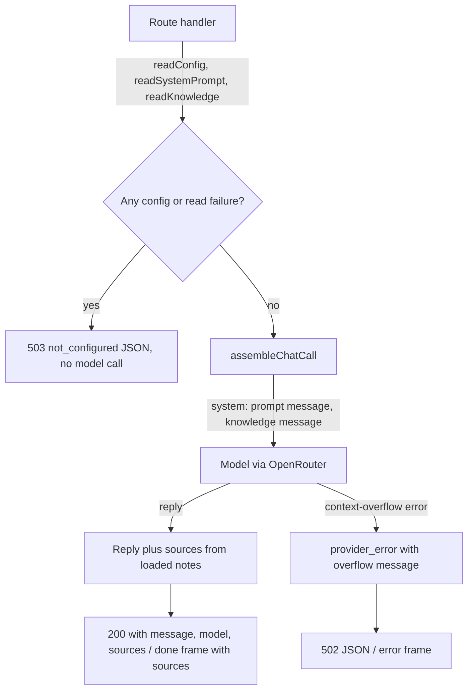

# Markdown Knowledge Folder, Stage 1 - Plan

## Goal Capsule

- **Objective:** Filip points Spekter at a folder of `.md` notes, and every reply can draw on them. The caller can see which notes went into each reply, and an edit to a note shows up on the next request.
- **Means:** One optional config value names the folder. Every note is read fresh on each request and attached at the assembly point as its own block, separate from the system prompt (KTD1, KTD3). Every successful reply lists the sources it touched (KTD4).
- **Product authority:** Linear SPE-6, then this plan's Key Decisions, then `STRATEGY.md` (Tools and knowledge track).
- **Implementation authority:** Product Contract wins on behavior. Planning Contract KTDs win on mechanism. Implementation Units override neither.
- **Stop conditions:** Stop and ask if meeting the requirements would mean renaming or removing an existing response field, adding an error code, or letting a configured but unreadable folder pass silently.
- **Execution profile:** Local single-developer change on the Next.js 16 app. No deployment, no migrations, no stored data.
- **Finisher:** `ce-work` (or Filip) implements and verifies. Filip runs the live checks with his own OpenRouter key.

---

## Product Contract

### Summary

The core chat API loads every `.md` file from one configured folder into the model context on each request. Each note is labelled with its path inside the folder. Both chat endpoints get the notes through the shared assembly point, kept apart from the system prompt. Every successful reply now carries a `sources` list naming the external sources that went into it; for now those are the knowledge files. With no folder configured, the model sees exactly what it sees today and `sources` is empty. Notes too large for the model produce an error that says so.

### Problem Frame

Notes are one of the knowledge sources `STRATEGY.md` says the agent should reach, and today the only way to get them in is to paste them into the conversation or the system prompt. SPE-6 is the simplest version: put every note in the context. It doubles as the baseline that stage 2 (read-file tools) gets measured against, so it has to be predictable and clear about where it stops working. During planning Filip also asked for each reply to say which files were read. In stage 1 every note is loaded, so the list shows what the model was given, not what it relied on. The list becomes more informative once stage 2 lets the model choose.

### Key Decisions

- **Every reply lists its external sources in an added `sources` field.** Requested by Filip during planning. This replaces the issue's "contract unchanged" criterion with "existing fields and error codes unchanged; one field added". Governs R7, R8, R9.
- **The sources list is general, not knowledge-specific.** Each entry names its kind, so stage 2 tools, MCP, and Google Docs can add entries without another contract change. Governs R7.
- **Subfolders count; hidden files and folders do not.** A notes folder usually has structure, and dotfiles are tool state, not notes. Governs R2.
- **A configured but unreadable folder is a configuration error.** Matches how the system prompt file behaves (SPE-5), so a typo in the path never silently drops all knowledge. Governs R5.
- **Context overflow is caught when the provider reports it, not estimated beforehand.** Counting tokens up front would need each model's context limit and a tokenizer per provider. The cost: on the streaming endpoint the error arrives as an error frame after the stream starts. Governs R10.

### Requirements

**Loading notes**

- R1. When a folder is configured, the model receives the full content of every `.md` note in it on each request, read fresh so an edit or a new note takes effect on the next request with no restart.
- R2. Notes in subfolders are included. Files and folders whose name starts with `.` are skipped, as are files that are empty after trimming whitespace. Notes are ordered by their path, so the same folder always produces the same context.
- R3. Each note in the context is labelled with its path relative to the configured folder, so the model can tell which note a piece of content came from.
- R4. Knowledge attaches at the single assembly point as its own block, separate from the system prompt, with no endpoint-specific wiring.

**No folder, bad folder**

- R5. A configured folder that is missing, unreadable, or not a directory produces the documented `not_configured` (503) error naming the folder, before the streaming endpoint sends anything. A note that cannot be read is the same error, naming the note.
- R6. With no folder configured, or a folder with no notes, the model call carries exactly today's content: the system prompt if configured, then the caller's messages.

**Sources in the response**

- R7. Every successful reply includes `sources`: a list with one entry per knowledge note sent to the model, each giving its kind and its path relative to the folder, in the same order as the context.
- R8. `POST /api/chat` returns `sources` next to `message` and `model`. On `POST /api/chat/stream`, the final `done` frame carries `sources`. Error responses and error frames do not.
- R9. `sources` is always present on success, as an empty list when nothing external was touched. All existing fields, frames, error shapes, and error codes stay as they are.

**Too large**

- R10. When the provider rejects a request because the context is too long, the caller gets a `provider_error` whose message says the context exceeded the model's limit. When notes were loaded, the message also gives the note count and total size and names `SPEKTER_KNOWLEDGE_DIR`. It replaces the provider's raw text, which is kept at the end of the message.

### Acceptance Examples

- AE1. **Covers R1, R3, R7, R8.** Given `SPEKTER_KNOWLEDGE_DIR` points at a folder holding `projects/apollo.md` that says "Apollo's launch date is 14 March", asking "When does Apollo launch?" gets a reply naming 14 March. On `/api/chat` the response includes `sources: [{ "type": "knowledge_file", "path": "projects/apollo.md" }]`, and on `/api/chat/stream` the `done` frame carries the same list.
- AE2. **Covers R1.** After editing that note to say 21 March, the next request answers 21 March with no restart.
- AE3. **Covers R6, R9.** With the variable unset, the model sees only the system prompt (if any) and the caller's messages, and the response is today's shape plus `"sources": []`.
- AE4. **Covers R5.** With the variable pointing at a folder that does not exist, both endpoints return 503 `not_configured` naming the folder, and the stream endpoint sends no frame.
- AE5. **Covers R10.** With a folder far larger than the model's context, `/api/chat` returns 502 `provider_error` whose message names the context limit, the note count and size, and `SPEKTER_KNOWLEDGE_DIR`. `/api/chat/stream` ends with an error frame carrying the same code and message.

### Scope Boundaries

Non-goals, from the issue:

- No tools for reading files on demand (stage 2).
- No search, chunking, or embeddings.
- No other knowledge sources (Google Docs, MCP).

Considered and not built:

- No token counting before the call (Key Decision above). Revisit if the after-the-stream error frame proves confusing in the web chat.
- No size cap or truncation of notes. Silently dropping notes would hide the exact limit stage 1 exists to show. The overflow error covers the failure.
- No caching or file watching. Reading per request is what makes edits land on the next request, and a personal notes folder reads in milliseconds.
- No following of symlinks. It avoids loops and notes leaking in from outside the folder. Revisit if Filip's notes folder relies on symlinks.
- No file types other than `.md` (case-insensitive).

#### Deferred to Follow-Up Work

- Showing `sources` in the web chat. The API returns it, and the UI ignores it for now.
- Recording note count and total size in the request log, so stage 2's comparison has numbers to start from.
- Stage 2: read-file tools, which will add `sources` entries for the files the model actually opens.

### Sources

- Linear SPE-6: origin. Its five acceptance criteria map to R1 (answer from a note, edits take effect), R6 (unset is unchanged), R10 (clear overflow error), and R9 (contract, as revised by the first Key Decision).
- `docs/plans/2026-10-11-1621-feat-system-prompt-markdown-file-plan.md`: SPE-5, the pattern this plan mirrors (per-request reads in the routes, `not_configured` for a bad path).
- `CONCEPTS.md`: Assembly point, Brick.
- `src/core/chat/complete.ts`: `assembleChatCall`, the assembly point. It already passes the system prompt through the AI SDK `system` option.
- `src/core/chat/system-prompt.ts`: the resolver this plan's loader follows.

---

## Planning Contract

### Key Technical Decisions

- KTD1. **One optional variable, `SPEKTER_KNOWLEDGE_DIR`, names the folder, and the route handlers load it per request through a Core helper, like `readSystemPrompt`.** Loading in the routes, inside their existing try blocks, keeps a bad folder on the pre-stream JSON error path. `streamChat` is a lazy generator that first runs after the 200 status is sent. Relative paths resolve against the server working directory, as the prompt file and request log do. Governs R1, R5.
- KTD2. **The loader walks the folder with Node's recursive `readdir` and keeps only regular files ending in `.md`.** Symlinks show up as non-regular entries and are skipped (Scope Boundaries). Any entry with a path segment starting with `.` is skipped. Paths are reported with `/` separators relative to the folder and sorted by plain string comparison, so the order is stable across machines. Node 20.17 is installed, and recursive `readdir` with `withFileTypes` has been supported since 20.1. Governs R2, R3.
- KTD3. **Knowledge goes to the model as a second system message after the system prompt, passed through the AI SDK `system` option as a list.** AI SDK 6.0.297 accepts `system` as a string or a list of system messages. Putting system messages inside `messages` makes the SDK print a prompt-injection warning on every call (`standardizePrompt` in `node_modules/ai/dist/index.mjs`). Keeping knowledge as its own message lets the prompt file and the notes change independently, and the mock model's recorded prompt shows both as separate entries. Inside the message each note is wrapped in a delimiter carrying its relative path. The exact wording is the implementer's call, as long as each note's path appears right before its content. With no notes, no knowledge message is sent and the system prompt is passed as today. Governs R3, R4, R6.
- KTD4. **The core chat functions report sources: `completeChat` returns the reply text with its sources, and `streamChat` puts them on the `done` frame.** Sources come from the knowledge passed into the call, so stage 2 tool calls can add to the same list inside the Core without the routes changing. A source is a tagged object (`type: "knowledge_file"`, `path`). New kinds are new tags. The type lives in `src/core/chat/contract.ts` beside `ChatResponse`. (session-settled: user-directed — chosen over leaving the response contract unchanged as SPE-6 originally required: the caller should see which external sources went into each reply.) Governs R7, R8, R9.
- KTD5. **Context overflow is recognized from the provider error and rewritten in the Core, keeping the `provider_error` code.** Recognition matches the error message against known overflow wording ("maximum context length", "context length", "context window", "prompt is too long", "too many tokens"). It optionally also requires an HTTP 400 when the error is an AI SDK `APICallError`. Keeping `provider_error` leaves the status (502), the stream frame code, and the request-log error code as they are today, and the new message carries the clarity. One helper builds the message for both endpoints and receives the note count and total size. Governs R10.

### High-Level Technical Design

Request flow on both endpoints. The stream endpoint differs only in that sources travel on the `done` frame and overflow arrives as an error frame.

### Assumptions

- OpenRouter reports a context overflow as an error whose message contains one of the KTD5 phrases. The live check in the Verification Contract confirms this against the real provider, and the phrase list is adjusted there if it does not.
- For models with an 8k context or less, OpenRouter's default "middle-out" transform may compress an oversized prompt instead of rejecting it. The configured model (`anthropic/claude-haiku-4.5`, 200k context) is not affected, so this plan does not change provider transforms.

### Risks

- **Every request sends every note to OpenRouter.** This costs tokens on each request, and note content leaves the machine. Both are inherent to stage 1 and are documented in the README so Filip chooses the folder knowingly.
- **Overflow wording varies by upstream provider.** A missed phrase falls back to today's behavior: a `provider_error` with the raw provider message. The failure stays visible, just less clear.

---

## Implementation Units

### U1. Core knowledge loader

- **Goal:** Turn config and one folder into an ordered list of notes, or nothing, with clear errors.
- **Requirements:** R1, R2, R3, R5, R6.
- **Dependencies:** none.
- **Files:** create `src/core/knowledge/markdown-folder.ts`, `src/core/knowledge/markdown-folder.test.ts`.
- **Approach:** One async helper takes the env (defaulting to `process.env`) and returns the notes, each with its relative path and content. When the variable is unset or blank it returns an empty list without touching the filesystem. Otherwise it walks and filters per KTD2 and returns the content of each note verbatim. Folder and note read failures throw `NotConfiguredError` naming the path and `SPEKTER_KNOWLEDGE_DIR` (R5).
- **Patterns to follow:** `readSystemPrompt` (`src/core/chat/system-prompt.ts`) for env injection, trimming, path resolution, and the error. Temp-directory fixtures as in `src/app/api/chat/route.test.ts`.
- **Test scenarios:**
  - An unset or blank variable returns an empty list.
  - A folder with `b.md`, `a.md`, and `sub/c.md` returns all three in the order `a.md`, `b.md`, `sub/c.md`, with content verbatim (inner whitespace and trailing newlines preserved).
  - `notes.txt`, `.hidden.md`, and `.obsidian/x.md` are skipped. `UPPER.MD` is included.
  - A whitespace-only `.md` file is skipped.
  - An empty folder, or one with no `.md` files, returns an empty list.
  - A folder that does not exist throws `NotConfiguredError` naming the folder and the variable.
  - A path that points at a file rather than a folder throws the same error.
  - A `.md` note without read permission throws `NotConfiguredError` naming that note.
  - A symlink to a `.md` file inside the folder is skipped.
  - A relative variable value resolves against the working directory.
- **Verification:** the new tests pass with no network.

### U2. Attach knowledge at the assembly point and report sources from the Core

- **Goal:** The model receives the notes as their own system message on both endpoints, and the core functions return the sources.
- **Requirements:** R3, R4, R6, R7, R8, R9.
- **Dependencies:** U1 (the note type).
- **Files:** modify `src/core/chat/contract.ts`, `src/core/chat/stream-frames.ts`, `src/core/chat/complete.ts`, `src/core/chat/stream.ts`. Tests in `src/core/chat/complete.test.ts`, `src/core/chat/stream.test.ts`, `src/core/chat/stream-frames.test.ts`, `src/core/instrumentation/request-log.test.ts`.
- **Approach:**
  1. Add the source type and `sources` to `ChatResponse`, and add `sources` to the `done` frame (KTD4).
  2. Give `assembleChatCall` an optional notes argument. It builds the `system` list per KTD3 and leaves the messages and the reasoning-effort choice as they are.
  3. Have `completeChat` return text plus sources, and have `streamChat` put sources on `done`. Thread the notes through both.
  4. Update the existing tests the new shapes break: `done` frame literals in `stream.test.ts`, `stream-frames.test.ts`, and `request-log.test.ts` gain `sources: []`, and `complete.test.ts` assertions on the returned string read the text from the new return value. `tsconfig.json` includes test files, so `npm run build` fails until these are updated.
- **Execution note:** Extend the existing "no system prompt" and "prepends the system prompt" prompt assertions first. They pin what the model sees today and must keep passing unchanged when no notes are given.
- **Patterns to follow:** the mock-model prompt assertions already in `complete.test.ts` and `stream.test.ts`.
- **Test scenarios:**
  - With a system prompt and two notes, the recorded prompt is: the system prompt message, then one knowledge system message, then the caller's messages. The knowledge message contains each note's path followed by its content, in order. Asserted for `completeChat` and `streamChat`.
  - With notes and no system prompt, the recorded prompt starts with the knowledge message.
  - With no notes, the recorded prompt equals today's for both the with-prompt and no-prompt cases.
  - `completeChat` returns sources `[{ type: "knowledge_file", path }]` in note order, or an empty list with no notes.
  - The stream's `done` frame carries the same sources. Delta, reasoning, and error frames are unchanged.
  - Long notes with a short last caller message still select reasoning effort `none` (assert on `assembleChatCall`).
- **Verification:** the core chat tests pass. The existing prompt assertions changed only where the call shape forces it.

### U3. Clear error on context overflow

- **Goal:** A context-too-long provider failure reaches the caller as a message that says so, on both endpoints.
- **Requirements:** R10.
- **Dependencies:** U2 (notes reach the core functions).
- **Files:** modify `src/core/chat/complete.ts`, `src/core/chat/stream.ts`. Tests in `src/core/chat/complete.test.ts`, `src/core/chat/stream.test.ts`.
- **Approach:** Extend the existing `toProviderError` path with the KTD5 recognition. When an error matches, build the overflow message from the note count and total size of the notes passed to the call. Both the thrown error in `completeChat` and the error frame in `streamChat` use it. Errors that do not match keep today's behavior exactly.
- **Patterns to follow:** `toProviderError` and `failingModel` / streamed `error` parts in `src/core/testing/mock-model.ts`.
- **Test scenarios:**
  - `completeChat` with a model failing "This endpoint's maximum context length is 200000 tokens. However, you requested about 250000 tokens" and two notes rejects with `provider_error` whose message mentions the context limit, "2 notes", the total size, and `SPEKTER_KNOWLEDGE_DIR`, and ends with the provider text.
  - The same failure with no notes gives a context-limit message that does not mention the knowledge folder.
  - "prompt is too long: 250000 tokens > 200000 maximum" is recognized too.
  - An unrelated failure ("Rate limit exceeded") keeps today's message exactly.
  - `streamChat` with an overflow error part ends with one error frame carrying `provider_error` and the overflow message.
- **Verification:** the tests pass, and the existing provider-error tests are unchanged.

### U4. Wire both endpoints

- **Goal:** Both routes load knowledge per request and return sources.
- **Requirements:** R1, R5, R6, R8, R9.
- **Dependencies:** U1, U2.
- **Files:** modify `src/app/api/chat/route.ts`, `src/app/api/chat/stream/route.ts`. Tests in `src/app/api/chat/route.test.ts`, `src/app/api/chat/stream/route.test.ts`.
- **Approach:** In each handler, call the U1 loader inside the existing try block next to `readSystemPrompt()` and pass the notes to the core call (KTD1). The complete route adds `sources` to its JSON body.
- **Patterns to follow:** the SPE-5 prompt-file route tests (temp dir, `vi.stubEnv`, mocked model).
- **Test scenarios:**
  - Covers AE1. With `SPEKTER_KNOWLEDGE_DIR` at a temp folder holding `projects/apollo.md`, `POST /api/chat` returns 200 with `message`, `model`, and `sources: [{ type: "knowledge_file", path: "projects/apollo.md" }]`, and the mocked model received the note in a system message.
  - The same folder on `POST /api/chat/stream` produces deltas then a `done` frame with that `sources` list.
  - Covers AE2. Editing the note between two requests changes the content the model receives on the second request.
  - Covers AE3. With the variable unset, `POST /api/chat` returns exactly today's body plus `sources: []`, and the model prompt equals today's.
  - Covers AE4. With the variable pointing at a missing folder, both endpoints return 503 `not_configured` naming the folder, the model is never called, and the stream endpoint returns JSON, not a 200 stream.
  - The existing exact-body assertions are updated to include `sources: []`: "returns the complete assistant reply" and the system-prompt success case in `route.test.ts`, plus the `done` frame expectations in `stream/route.test.ts`. Error-path assertions do not change.
- **Verification:** the full suite passes.

### U5. Document the knob and the field

- **Goal:** Future Filip can configure the folder and read `sources` from `.env.example` and the README without reading code.
- **Requirements:** R1, R5, R7, R8, R9, R10.
- **Dependencies:** U1 to U4. Names and behavior must match what shipped.
- **Files:** modify `.env.example`, `README.md`.
- **Approach:**
  1. `.env.example`: a commented `SPEKTER_KNOWLEDGE_DIR` entry covering path resolution, which files count, and the unset, empty, and missing outcomes.
  2. `README.md`, Core chat API section: a paragraph on the knowledge folder (read fresh per request, both endpoints, sent to OpenRouter on every request), `sources` in the success example and a short description of entries, `sources` on the `done` frame in the streaming frame table and example, the `not_configured` row extended to the folder, and the `provider_error` row noting the overflow message.
- **Test scenarios:**
  - Test expectation: none -- documentation-only. Checked by matching the shipped variable name, field names, frame shape, and error behavior.
- **Verification:** the README contains no stale claims. The success example, frame table, error table, and new paragraph all match what shipped.

---

## Verification Contract

| Check | Proves |
| --- | --- |
| `npm test` | R2 to R10 through the loader, core, and route tests, with no network and no credits |
| `npm run lint` | touched files pass lint |
| `npm run build` | the added `sources` field and `done` frame field type-check across the app, web client, and tests (`tsconfig.json` includes test files) |
| Live answer and freshness check (needs `OPENROUTER_API_KEY` in `.env.local`) | R1 end to end, plus AE1 and AE2: start `npm run dev`, point `SPEKTER_KNOWLEDGE_DIR` at a folder with a note holding a fact the model cannot know, curl the question, check the answer and `sources`, edit the note, and curl again without restarting |
| Live overflow check | R10 against the real provider and the KTD5 assumption: point the folder at notes well over 200k tokens, curl both endpoints, and confirm the overflow message rather than the raw provider text. If the provider wording is not recognized, add its phrase and a unit test for it |

## Definition of Done

- SPE-6's acceptance criteria hold, with the contract criterion as revised: answer from a note (live), edits take effect (live and suite), unset is unchanged apart from `sources: []` (suite), clear overflow error (live and suite), existing fields and error codes unchanged (suite plus README review).
- Every successful reply on both endpoints carries `sources`.
- `npm test`, `npm run lint`, and `npm run build` pass.
- `.env.example`, `README.md`, and the `CONCEPTS.md` "Source" entry match what shipped.
- Experimental helpers, fixtures, and abandoned approaches are removed from the diff.
