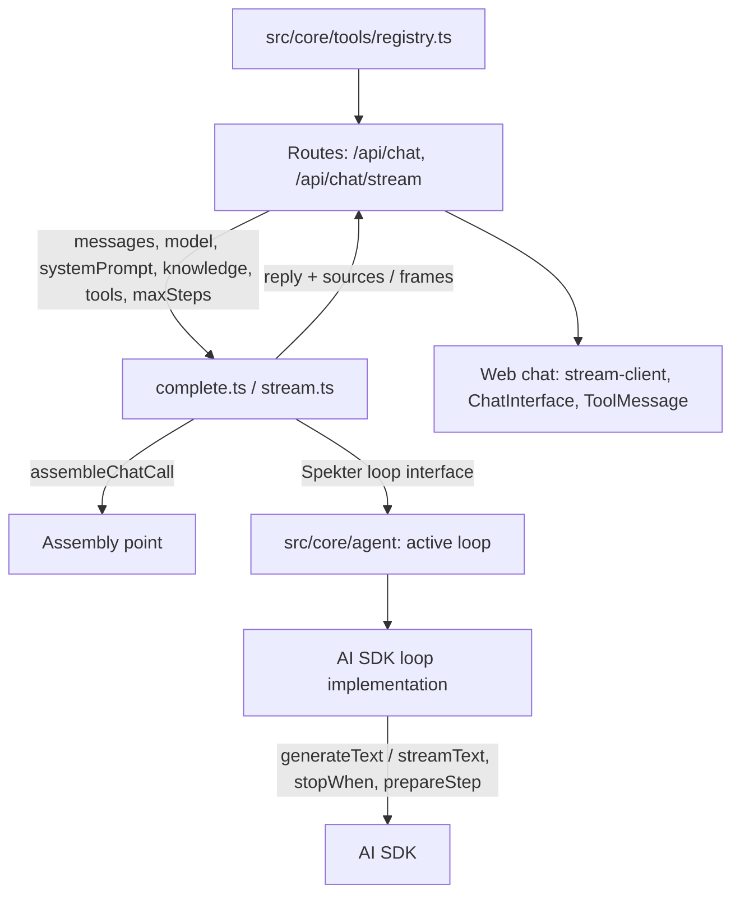
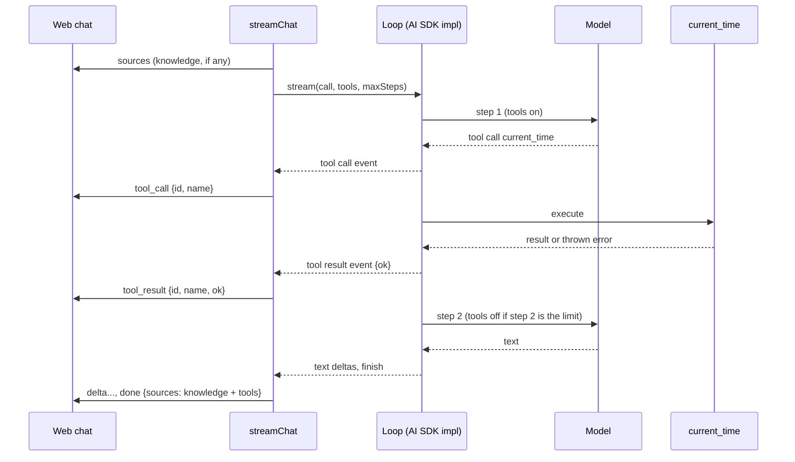

# Tool-Calling Agent Loop - Plan

## Goal Capsule

- **Objective:** Filip asks Spekter something only a tool can answer and gets a correct reply built from the tool's result. He sees in the web chat which tool ran, when, and whether it worked. A question needing no tool behaves as it does today.
- **Means:** The AI SDK's multi-step loop, hidden behind a Spekter-owned agent loop seam (KTD1). Tools are registered once in Spekter's own shape (KTD2), and a step limit ends with a tool-free final turn (KTD4).
- **Product authority:** Linear SPE-7, then this plan's Key Decisions, then `STRATEGY.md` (Backend track: agent loop as a Brick).
- **Implementation authority:** Product Contract wins on behavior. Planning Contract KTDs win on mechanism. Implementation Units override neither.
- **Stop conditions:** Stop and ask if meeting the requirements would mean renaming or removing an existing response field or frame, adding an error code, or importing the AI SDK's loop API (`generateText`, `streamText`, `tool`, `stepCountIs`) anywhere outside `src/core/agent/`.
- **Execution profile:** Local single-developer change on the Next.js 16 app. No deployment, no migrations, no stored data.
- **Finisher:** `ce-work` (or Filip) implements and verifies. Filip runs the live checks with his own OpenRouter key.

---

## Product Contract

### Summary

Both chat endpoints run the model in a loop. The model can call registered tools, gets their results back, and keeps going until it writes its reply. One built-in tool, `current_time`, proves the loop. A configurable step limit caps each request, and the last allowed step always has tools turned off, so the model must answer with what it has. The streaming endpoint announces each tool call and its outcome as new frames, and the web chat shows them in the conversation. Every successful reply lists the tools it used as sources, next to the knowledge notes. A tool that fails reports its error to the model rather than failing the request.

### Problem Frame

`STRATEGY.md` names the agent loop as one of the core Bricks, and the Tools and knowledge track (MCP servers, read-file tools, Google Docs) cannot start until the model can call something. Today each request is a single model call. The loop also has to stay swappable: a hand-rolled loop or LangGraph is a planned experiment, and the swap time is one of Spekter's key metrics. So this ticket has to put the AI SDK's loop behind a seam Spekter owns, not just switch it on. During planning Filip asked to see tool activity live in the web chat, which the issue's "contract unchanged" criterion would otherwise have ruled out.

### Key Decisions

- **The stream announces tool calls with new frame types, and the web chat shows them.** (session-settled: user-directed — chosen over keeping the stream's frame set unchanged: Filip wants to see in the web UI when a tool is called and which one.) This revises the issue's "contract unchanged" criterion to "existing fields, frames, and error codes unchanged; frames and source kinds added", the same way SPE-6 added `sources`. Governs R9, R10, R11.
- **At the step limit the model gives a best-effort reply.** (session-settled: user-directed — chosen over ending the request with a clear error: a reply built from what the tools already returned is more useful than an error.) Governs R6, R7.
- **Tools the model used are listed as sources.** (session-settled: user-approved — chosen over leaving tools out of sources until the logging ticket: the Source concept already anticipates tools as a new kind, and the complete-reply endpoint then also shows which tools ran.) Governs R12.
- **A failing tool's error goes back to the model as the tool's result.** (session-settled: user-approved — chosen over failing the request: the model can explain or work around the failure.) Governs R8.

### Requirements

**Tool loop**

- R1. On both endpoints the model can call any registered tool, receive its result, and continue over multiple steps before producing its final reply.
- R2. Tools are registered in one place in the Core, and both endpoints get the same tools with no endpoint-specific wiring.
- R3. A built-in `current_time` tool returns the current date and time with its timezone, so a question like "What's the date today?" is answered from the tool and not from training data.
- R4. A question that needs no tool gets a reply with the same content, fields, and frames as today, plus no tool frames and no tool sources.

**Limits and failures**

- R5. The maximum number of model steps per request is set by `SPEKTER_MAX_STEPS`, defaulting to 5. A value that is not a positive whole number produces the documented `not_configured` (503) error naming the variable, before the streaming endpoint sends anything.
- R6. When the model reaches the last allowed step, that step runs with tools turned off, so the request always ends within the limit with a reply built from the tool results gathered so far.
- R7. If the model still ends without a usable reply (no text, or it stopped wanting more tools), the request fails as `provider_error` with a message saying so. It never hangs or loops.
- R8. A tool that throws does not fail the request. The model receives the error as that tool's result and continues. The caller sees the failure on the stream as a failed tool result.

**Visibility**

- R9. `POST /api/chat/stream` sends a `tool_call` frame when the model calls a tool, naming the tool, and a `tool_result` frame when that call finishes, saying whether it succeeded. Both carry the same call id.
- R10. The web chat shows each tool call in the conversation as it happens: running, then used or failed. It never sends tool lines back to the model.
- R11. All existing response fields, frames, error shapes, and error codes stay as they are. New frame types and source kinds are the only additions.
- R12. Every successful reply's `sources` lists each tool that returned a result, once per tool name, after the knowledge notes, in the order the tools were first called. On `/api/chat` this is the response's `sources`. On `/api/chat/stream` it is the `done` frame's `sources`.

**Swappability**

- R13. Replacing the loop implementation touches only the agent loop module. The chat functions, routes, tools, and web chat depend on Spekter's own loop and tool types, never on the AI SDK's loop API.

### Acceptance Examples

- AE1. **Covers R1, R3, R9, R12.** Asking "What is today's date?" on `/api/chat/stream` produces `tool_call` `{ name: "current_time" }`, then `tool_result` `{ ok: true }`, then deltas giving today's date, then `done` with `sources` containing `{ "type": "tool", "name": "current_time" }`. `/api/chat` returns the same date and the same tool source.
- AE2. **Covers R4.** Asking "Say hi" produces no tool frames, and `sources` lists only knowledge notes, if any.
- AE3. **Covers R6.** With `SPEKTER_MAX_STEPS=2` and a request that makes the model want to call `current_time` three times, the model calls it once, then answers on step 2 without tools. The reply is a normal success.
- AE4. **Covers R8.** When a tool throws "clock unavailable", the stream shows `tool_result` with `ok: false`, and the reply still arrives and can mention that the tool failed. That tool is not in `sources`.
- AE5. **Covers R5.** `SPEKTER_MAX_STEPS=zero` makes both endpoints return 503 `not_configured` naming `SPEKTER_MAX_STEPS`, and the stream sends no frame.

### Scope Boundaries

Non-goals, from the issue:

- No MCP, no file tools, no hand-rolled or LangGraph loop, no tool-step logging.

Considered and not built:

- No tool arguments or results in the web chat or the frames. Filip asked to see which tool and when. Revisit when tools with meaningful inputs land (MCP, file tools).
- No tool approval step. `current_time` has no side effects. Revisit with the first tool that writes or spends.
- No per-tool timeout. `current_time` returns instantly, and a client abort already cancels the request. Revisit with the first networked tool.
- No tolerance for unknown frame types in the web client. Its frame handling ships in the same change as the new frames, so a mismatch shows up at once as an error in the chat.
- No interleaving of tool lines with text inside one reply. Tool lines sit above the reply, as source lines do. Revisit if interim narration ("let me check…") above the line reads badly.

#### Deferred to Follow-Up Work

- Tool-step logging (separate ticket): tool names, outcomes, and step counts in the request log.
- MCP tool source (separate ticket), which registers tools through the same registry.
- Alternative loop Bricks (hand-rolled, LangGraph) behind the same seam.

### Sources

- Linear SPE-7: origin. Its six acceptance criteria map to R1/R3 (tool answer), R4 (no-tool unchanged), R6/R7 (step limit), R8 (failing tool), R11 (contract, as revised by the first Key Decision), and R13 (swap).
- `CONCEPTS.md`: Brick, Assembly point, Source.
- `docs/plans/2026-10-12-1033-feat-md-knowledge-folder-plan.md`: SPE-6, the precedent for additive contract changes and the `sources` list.

---

## Planning Contract

### Key Technical Decisions

- KTD1. **The agent loop seam lives in `src/core/agent/`, with one Spekter-owned interface and one AI SDK implementation.** The interface takes the assembled model call, the tools, the step limit, and an abort signal. It offers a complete run that returns the final text, the finish reason, and the tool calls with their outcomes, and a streamed run that yields Spekter's own events: text delta, reasoning delta, tool call, tool result, error, abort, finish. `complete.ts` and `stream.ts` call the interface and map its results to the existing reply and frames. One small module picks the active implementation, so a swap changes that module and adds a file beside it. `assembleChatCall` keeps returning AI SDK message and model types. Those belong to the model provider Brick, which this ticket does not swap. Governs R1, R13.
- KTD2. **Tools are defined in a Spekter shape — name, description, zod input schema, async execute — and converted to AI SDK tools only inside the loop implementation.** `zod` is already the request-validation library. The registry is one exported list in `src/core/tools/registry.ts`. The routes pass it in through `ChatContext`, as they pass the system prompt and knowledge. A call with no tools makes exactly today's model call: no `tools` option and no step limit. That keeps every existing prompt assertion valid. Governs R2, R4, R13.
- KTD3. **`current_time` takes no input and returns the server's current time as ISO 8601, plus the IANA timezone from `Intl`.** Tests freeze the clock. Governs R3.
- KTD4. **The step limit uses the SDK's step-count stop condition, and the last allowed step runs with tool choice `none`.** Before each step, the implementation checks whether it is step `limit - 1` and, if so, turns tool choice off. This keeps the best-effort turn inside the limit, with no extra call. Tool choice `none` keeps the tool definitions in the request. Some providers reject a request whose history holds tool calls and results but defines no tools, so removing the tools (empty active tools) is riskier. With a limit of 1, the only step is tool-free. (session-settled: user-directed — chosen over ending at the limit with an error: Filip prefers a best-effort reply.) Governs R5, R6.
- KTD5. **A final finish reason of `tool-calls` counts as an incomplete reply on both endpoints.** It means the model ignored tool choice `none` or the loop ended mid-plan. Adding it to the existing incomplete-reason set gives the R7 error through today's code path and adds no error code. Without tools this finish reason never occurs, so nothing changes today. Governs R7.
- KTD6. **`/api/chat` returns the final step's text, and the stream sends text from every step as it arrives.** The SDK's complete result exposes the last step's text. The stream cannot hold back interim narration without buffering every step, and buffering would defeat streaming. The difference shows up only when the model writes text before a tool call. Governs R1, R4.
- KTD7. **Tool failures surface through the SDK's tool-error parts, mapped to a failed tool-result event.** The SDK already sends a thrown error back to the model as the tool's output and continues the loop. Calls to an unknown tool, or with input that fails the schema, are expected to arrive the same way (see Assumptions). (session-settled: user-approved — chosen over failing the request: the model can explain or recover.) Governs R8.
- KTD8. **New frames: `{ type: "tool_call", id, name }` and `{ type: "tool_result", id, name, ok }`. New source kind: `{ type: "tool", name }`.** Snake case matches the existing error codes, and `id` is the SDK's tool call id. The initial `sources` frame still carries only knowledge, because tools aren't known before the reply starts. The `done` frame carries the full list. The request log passes the new frames through unchanged, since it only reacts to `done` and `error`. (session-settled: user-directed — chosen over no new frames: Filip wants to see tool calls in the web UI.) Governs R9, R11, R12.
- KTD9. **The web chat shows each call as a display-only `tool` message, inserted above the reply like source lines and updated in place when its result arrives.** It has three states: running, used, and failed. The source line component narrows to `knowledge_file`, since tool sources reach the UI only through tool frames. `toConversation` already sends only user and assistant messages back, so tool messages never reach the model. Governs R10.
- KTD10. **`SPEKTER_MAX_STEPS` is read in `readConfig`, alongside the required variables, as an optional field with default 5.** That keeps a bad value on the pre-stream JSON error path, and the routes already call `readConfig` inside their try blocks. The value 5 leaves room for a few tool calls while bounding the cost of a runaway request. Governs R5.

### High-Level Technical Design

Dependency direction: only the AI SDK implementation imports the SDK's loop API.

One streamed request that uses a tool:

### Assumptions

- AI SDK 6.0.297 turns a call to an unknown tool, or one with schema-failing input, into a tool-error part and continues the loop, rather than throwing. U2 includes a test that pins this. If the SDK throws instead, the request fails as `provider_error` through the existing error path. That is visible but breaks R8 for those cases, so the implementer reports it rather than adding repair logic.
- OpenRouter forwards tool choice `none` to the configured model (`anthropic/claude-haiku-4.5`). If a model ignores it, KTD5 turns the result into a clear error rather than a hang.

### Risks

- **Each tool step is another paid model call.** The step limit bounds it. With the default of 5, a request costs at most five times a single-call request.
- **Interim narration appears in the streamed reply but not in `/api/chat`** (KTD6). The two endpoints can show slightly different text for the same tool-using answer. This is documented in the README.

---

## Implementation Units

### U1. Spekter tool shape, registry, and `current_time`

- **Goal:** Tools exist in a Spekter-owned shape with one registry and one built-in tool.
- **Requirements:** R2, R3, R13.
- **Dependencies:** none.
- **Files:** create `src/core/tools/types.ts`, `src/core/tools/registry.ts`, `src/core/tools/current-time.ts`, `src/core/tools/current-time.test.ts`.
- **Approach:** Define the tool type per KTD2. Implement `current_time` per KTD3. Export the registry as a list containing it.
- **Patterns to follow:** plain exported functions and types as in `src/core/knowledge/markdown-folder.ts`. Fake timers in Vitest.
- **Test scenarios:**
  - With the clock frozen at `2026-10-12T11:18:00Z`, execute returns that instant in ISO 8601 and a non-empty timezone string.
  - The registry contains exactly one tool named `current_time`, with a description and an input schema that accepts an empty object.
- **Verification:** the new tests pass. Nothing in `src/core/tools/` imports from `ai`.

### U2. Agent loop seam and AI SDK implementation

- **Goal:** One Spekter interface runs the multi-step loop, complete or streamed, with the step limit and failure behavior.
- **Requirements:** R1, R6, R7, R8, R13.
- **Dependencies:** U1.
- **Files:** create `src/core/agent/loop.ts` (interface and event types), `src/core/agent/ai-sdk-loop.ts`, `src/core/agent/index.ts` (active loop), `src/core/agent/ai-sdk-loop.test.ts`. Modify `src/core/testing/mock-model.ts`.
- **Approach:**
  1. Define the interface and event union per KTD1.
  2. In the implementation, convert Spekter tools to SDK tools (KTD2), apply the stop condition and the last-step tool choice (KTD4), and pass the abort signal through.
  3. Map the SDK's tool-call, tool-result, and tool-error parts to Spekter events (KTD7, KTD8). Collect tool outcomes for the complete run.
  4. With no tools, pass neither `tools` nor a stop condition (KTD2).
  5. Add scripted mock helpers that return a different response per call (tool call first, then text), for both generate and stream.
- **Execution note:** Write the step-limit and no-tools tests first. They pin the two behaviors most likely to regress silently.
- **Patterns to follow:** `MockLanguageModelV3` usage and `doGenerateCalls` / `doStreamCalls` assertions in `src/core/chat/complete.test.ts` and `src/core/chat/stream.test.ts`.
- **Test scenarios:**
  - Complete run: the model calls `current_time`, then replies. The result has the final text and one tool call with `ok: true`, and the second model call's prompt contains the tool result.
  - Streamed run: the same script yields a tool call event, a tool result event with `ok: true`, text deltas, and a finish event, in that order.
  - A limit of 2 with a model that always calls the tool: the recorded second call has tool choice `none`, and there are exactly two model calls.
  - A limit of 1: the only call has tool choice `none`.
  - A tool whose execute throws "clock unavailable": the run continues, the tool result is `ok: false`, and the next prompt contains the error text.
  - The model calls an unknown tool name: pins the Assumption. The run continues with a failed tool result, or the test documents that the SDK throws.
  - No tools: the recorded call has no `tools`, and only one model call is made even if the mock returns finish reason `tool-calls`.
  - Aborting mid-stream yields an abort event and no further events.
- **Verification:** the loop tests pass with no network. Only files under `src/core/agent/` import `generateText`, `streamText`, `tool`, or `stepCountIs`.

### U3. Chat functions use the seam, report tool sources, and emit tool frames

- **Goal:** Both endpoints' core functions run through the loop. The stream emits tool frames, and both report tool sources.
- **Requirements:** R1, R4, R7, R9, R11, R12.
- **Dependencies:** U2.
- **Files:** modify `src/core/chat/contract.ts`, `src/core/chat/stream-frames.ts`, `src/core/chat/complete.ts`, `src/core/chat/stream.ts`. Tests in `src/core/chat/complete.test.ts`, `src/core/chat/stream.test.ts`, `src/core/chat/stream-frames.test.ts`.
- **Approach:**
  1. Add the tool source kind and the two frame types (KTD8).
  2. Extend `ChatContext` with optional tools and step limit (KTD2).
  3. Replace the direct `generateText` / `streamText` calls with the active loop. Keep `assembleChatCall`, error mapping, and the up-front `sources` frame as they are.
  4. Add `tool-calls` to the incomplete finish reasons (KTD5).
  5. Build sources as knowledge, then deduplicated successful tool names in first-call order (R12).
- **Execution note:** Run the existing chat tests unchanged before editing. They must still pass with no tools in context. That is the R4 proof.
- **Patterns to follow:** `knowledgeSources` and the frame switch in `src/core/chat/stream.ts`.
- **Test scenarios:**
  - Covers AE1. `completeChat` with `current_time` and a scripted model returns the final text and `sources` ending with `{ type: "tool", name: "current_time" }`.
  - Covers AE1. `streamChat` yields `tool_call`, `tool_result` (`ok: true`), deltas, then `done` whose sources include the tool after any knowledge notes.
  - Covers AE2. With tools available but a model that just replies, the frames and return value equal today's.
  - Covers AE4. A throwing tool gives `tool_result` with `ok: false`, the reply still completes, and the tool is absent from `sources`.
  - Two calls to `current_time` in one request list it once in `sources`.
  - A final finish reason of `tool-calls` fails `completeChat` with `provider_error` and ends the stream with an error frame naming the finish reason.
  - The existing prompt, reasoning-effort, overflow, and abort tests pass unchanged.
- **Verification:** all core chat tests pass. `npm run build` type-checks the new frame union everywhere it is switched on.

### U4. Routes and config wire tools and the step limit

- **Goal:** Both endpoints pass the registry and the configured step limit, and a bad limit fails before streaming.
- **Requirements:** R2, R5.
- **Dependencies:** U3.
- **Files:** modify `src/core/config.ts`, `src/app/api/chat/route.ts`, `src/app/api/chat/stream/route.ts`, `.env.example`. Tests in `src/core/config.test.ts`, `src/app/api/chat/route.test.ts`, `src/app/api/chat/stream/route.test.ts`.
- **Approach:** Add the optional `maxSteps` to `Config` (KTD10). Both routes pass the registry and `config.maxSteps` in the chat context, next to the system prompt and knowledge.
- **Patterns to follow:** the missing-variable handling in `readConfig`, and the `not_configured` route tests in both route test files.
- **Test scenarios:**
  - Unset or blank `SPEKTER_MAX_STEPS` gives 5. `"3"` gives 3.
  - Covers AE5. `"0"`, `"-1"`, `"2.5"`, and `"zero"` each throw `NotConfiguredError` naming `SPEKTER_MAX_STEPS`.
  - Covers AE5. The stream route with an invalid value returns 503 JSON and no stream body.
  - Both routes offer `current_time` to the model (assert on the mock's recorded tools).
- **Verification:** route and config tests pass.

### U5. Web chat shows tool calls

- **Goal:** Each tool call appears in the conversation as it happens, with its outcome.
- **Requirements:** R10, R11.
- **Dependencies:** U3.
- **Files:** modify `src/components/chat/stream-client.ts`, `src/components/chat/types.ts`, `src/components/chat/ChatInterface.tsx`, `src/components/chat/ChatMessageBubble.tsx`. Tests in `src/components/chat/stream-client.test.ts`.
- **Approach:**
  1. Add optional `onToolCall` / `onToolResult` handlers to the stream client, so the two new frames stop falling into the error branch.
  2. Add the `tool` role and its call id, name, and state to the chat message type (KTD9).
  3. In `ChatInterface`, insert a running tool message before the reply on `tool_call`, and update it by id on `tool_result`.
  4. Add a `ToolMessage` component styled like `SourceMessage`: a tool icon from `lucide-react`, "Calling `name`" with the `text-flare` animation while running, then "Used `name`" or "`name` failed".
  5. Narrow `SourceMessage` to `knowledge_file` sources.
- **Patterns to follow:** `onSources` handling and `insertBeforeReply` in `ChatInterface.tsx`, and `SourceMessage` / `ReasoningMessage` in `ChatMessageBubble.tsx`.
- **Test scenarios:**
  - A stream of `tool_call`, `tool_result`, `delta`, `done` calls `onToolCall`, `onToolResult`, `onDelta`, and `onDone` in order, and never `onError`.
  - `toConversation` drops `tool` messages.
  - UI states: Test expectation: none -- the repo has no component test setup. Covered by the live check in the Verification Contract.
- **Verification:** stream-client tests pass. In the browser, AE1 shows a running line that turns into "Used current_time" above the reply.

### U6. Documentation

- **Goal:** README and CONCEPTS describe the loop, the tool, the limit, and the new frames and source kind.
- **Requirements:** R5, R9, R12, R13.
- **Dependencies:** U3, U4.
- **Files:** modify `README.md`, `CONCEPTS.md`.
- **Approach:**
  1. In the README, describe tools and `SPEKTER_MAX_STEPS` in the Core chat API section. Add the `tool` source kind to the `sources` paragraph and the two frames to the frame table.
  2. Note KTD6's text difference between the endpoints, and that the `not_configured` row now also covers `SPEKTER_MAX_STEPS`.
  3. In CONCEPTS, add an "Agent loop" entry for the seam and a "Tool" entry.
- **Test expectation:** none -- documentation only.
- **Verification:** the README examples match the frame and source shapes in `src/core/chat/stream-frames.ts` and `src/core/chat/contract.ts`.

---

## Verification Contract

| Gate | Command or check | Proves |
| --- | --- | --- |
| Unit tests | `npm run test` | U1-U5 scenarios. No network, no credits |
| Lint | `npm run lint` | Style and hooks rules |
| Type check and build | `npm run build` | New frame and source unions handled everywhere, test files included |
| Seam boundary | Search `src/` for imports of `generateText`, `streamText`, `stepCountIs`, `tool` from `ai`: only `src/core/agent/ai-sdk-loop.ts` | R13 |
| Live: tool answer | With the dev server and a real key, ask "What is today's date?" in the web chat and with curl against `/api/chat` | AE1, R10 |
| Live: no tool | Ask "Say hi" | AE2 |
| Live: step limit | `SPEKTER_MAX_STEPS=2`, ask the model to check the time three separate times before answering | AE3, and the tool choice `none` Assumption |

## Definition of Done

- Every U-ID's verification holds, and all Verification Contract gates pass.
- All five Acceptance Examples are confirmed: AE1-AE3 live, AE4-AE5 by tests.
- The README frame table and `sources` description match the code.
- No code from abandoned approaches is left in the diff, and nothing outside `src/core/agent/` imports the SDK's loop API.
