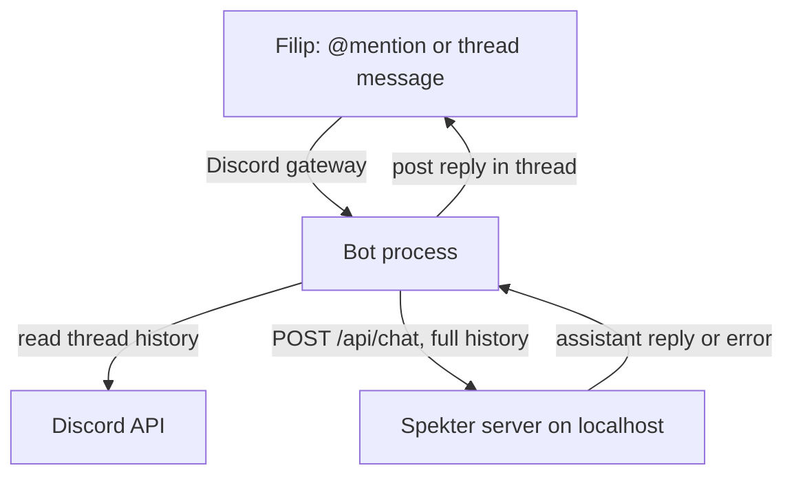
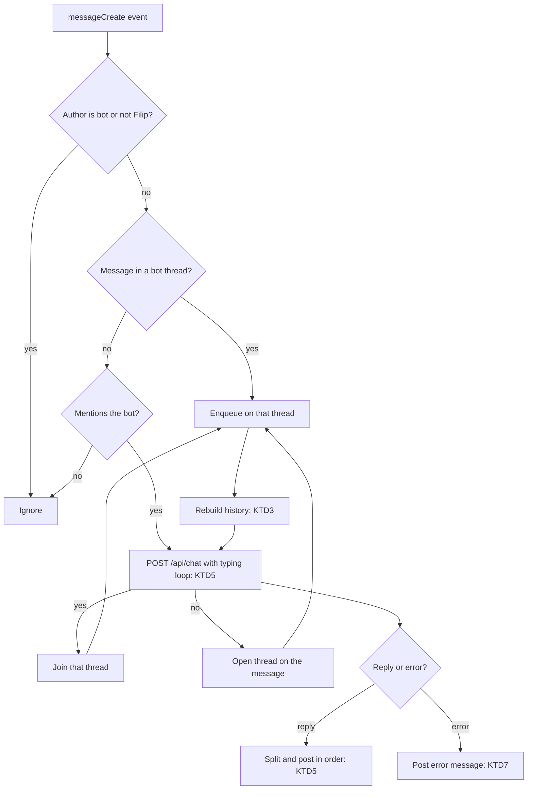

# Discord Bot Interface - Plan

## Goal Capsule

- **Objective:** Filip can hold multi-turn conversations with his agent from his private Discord server — each Discord thread an independent conversation — while everything runs locally.
- **Means:** A standalone local bot process (a new Interface) that connects to Discord's gateway and forwards thread conversations to `POST /api/chat` on localhost.
- **Product authority:** This Product Contract, then `STRATEGY.md`. Deployment, the server-side access gate, other messaging interfaces, and conversation persistence are not active scope.
- **Implementation authority:** Product Contract wins on behavior; Planning Contract KTDs win on mechanism; Implementation Units override neither.
- **Stop conditions:** Stop and ask if meeting a requirement would mean changing the `/api/chat` contract or adding server-side state.
- **Execution profile:** Local single-developer change on a Next.js 16 app plus a new long-running bot process; no deployment, no migrations, no persistence.
- **Finisher:** `ce-work` (or Filip) implements and verifies; Filip does the Discord Developer Portal setup and runs the live check in his own server.
- **Open blockers:** None.

---

## Product Contract

### Summary

Spekter gets a Discord Interface: a local bot process that turns Discord threads in Filip's private server into conversations with the agent, using the same `/api/chat` contract as every other client.

### Problem Frame

The web chat is the only Interface today, so talking to the agent means opening the app.
STRATEGY.md names Discord as one of the planned Interfaces ("each just another client of the core"), and Filip prefers Discord while at the computer.
The SPE-1 plan anticipated this client: the API is stateless and the caller owns history specifically so a messaging bot could use it unchanged.

### Key Decisions

- **Local bot process over HTTP, not in-process core import.** (session-settled: user-approved — proposed in the approach review and confirmed: the route layer's assembly — commands, system prompt, knowledge, tools, logging — is reused unchanged; importing the core directly would duplicate it.) Governs R1.
- **Threads are conversations.** (session-settled: user-directed — chosen over channel-as-conversation in memory, channel-as-conversation persisted, and one-shot messages.) Governs R2, R3, R4.
- **An @mention spawns the thread.** (session-settled: user-directed — chosen over a dedicated auto-threading channel and over manually created threads.) Governs R2.
- **The Discord thread is the memory; nothing is stored.** (session-settled: user-approved — proposed in the scope call-outs and confirmed: history rebuilds from visible thread messages, so a restart loses nothing.) Governs R4, R5.
- **Typing indicator, then the complete reply.** (session-settled: user-directed — chosen over tool-call narration, progressive streaming edits, and narration plus streaming.) Governs R6.
- **Only Filip's Discord account is served.** (session-settled: user-approved — proposed as the access safeguard in the scope call-outs and confirmed.) Governs R9.

### Requirements

**Conversation shape**

- R1. A locally-running bot process connects to Discord's gateway and forwards conversations to `POST /api/chat` on the same machine; the core API and its contract are unchanged.
- R2. @mentioning the bot in a server channel opens a thread where that conversation lives; the mention's text becomes the conversation's first user message.
- R3. Each thread is an independent conversation: a message from Filip inside a thread continues that thread's conversation, with no repeat mention needed.
- R4. Conversation history is rebuilt from the thread's visible Discord messages — the bot's replies map to assistant turns, Filip's messages to user turns — so no state is stored and a bot restart loses nothing.
- R5. The history sent to the API is bounded; when a thread outgrows the window, the most recent messages are kept.

**Reply behavior**

- R6. While a reply is being generated the bot shows Discord's typing indicator, and the complete reply is posted in the thread when it arrives.
- R7. A reply longer than Discord's message limit is posted as consecutive messages in order, never truncated.
- R8. An API error surfaces as a Discord message naming what went wrong, never as a fabricated assistant reply.

**Access and edges**

- R9. Only messages from Filip's Discord account trigger replies or enter conversation history; messages from any other user or bot are ignored.
- R10. A message with no readable text (for example, attachment-only) gets a reply saying the bot can't read it.
- R11. Text slash commands in a message pass through to the API unchanged, so commands like `/fast` or `/help` work from Discord.

**Running it**

- R12. The bot authenticates with a Discord bot token read from environment configuration; a missing token fails at startup with a clear error.
- R13. The bot starts via a single repo script and runs alongside `next dev`.

### Key Flows



- F1. Start a conversation
  - **Trigger:** Filip @mentions the bot in a channel.
  - **Steps:** The bot opens a thread under his message, shows typing, forwards the mention text as the conversation's first user message, and posts the reply in the thread.
  - **Covered by:** R1, R2, R6, R7
- F2. Continue a conversation
  - **Trigger:** Filip sends a message inside a bot thread.
  - **Steps:** The bot rebuilds the thread's history, appends the new message, calls the API, and posts the reply in the thread.
  - **Covered by:** R3, R4, R5, R6
- F3. Bot restarts mid-conversation
  - **Trigger:** The bot process restarts.
  - **Steps:** The next message in an existing thread rebuilds history from Discord and the conversation continues with earlier context intact.
  - **Covered by:** R4
- F4. API failure
  - **Trigger:** The API returns an error response.
  - **Steps:** The bot posts the error's message in the thread instead of a reply.
  - **Covered by:** R8

### Acceptance Examples

- AE1. Multi-turn in a thread
  - **Covers:** R1, R2, R3, R4, R6
  - **Given:** The server and bot are running locally and the bot is in Filip's private server.
  - **When:** Filip @mentions the bot with a question, then sends a follow-up inside the created thread that depends on the first answer.
  - **Then:** The bot's second reply answers the follow-up in context, in the thread.
- AE2. Restart keeps context
  - **Covers:** R4
  - **Given:** An active thread with several exchanges.
  - **When:** The bot process restarts and Filip sends another message in that thread.
  - **Then:** The reply still reflects the earlier conversation.
- AE3. Long reply splits
  - **Covers:** R7
  - **Given:** A working setup.
  - **When:** The assistant's reply exceeds Discord's message limit.
  - **Then:** It appears as consecutive messages in order, with nothing cut.
- AE4. Provider not configured
  - **Covers:** R8
  - **Given:** The API is running without an OpenRouter key.
  - **When:** Filip messages the bot.
  - **Then:** The thread gets a clear error message, not a chat reply.
- AE5. Stranger is ignored
  - **Covers:** R9
  - **Given:** A working setup.
  - **When:** An account other than Filip's @mentions the bot or posts in one of its threads.
  - **Then:** Nothing is sent to the API and no reply is posted.

### Scope Boundaries

- Streaming replies or tool-call narration in Discord — declined in dialogue; a later interface version can adopt `/api/chat/stream`.
- Native Discord slash commands — text commands pass through per R11.
- Direct messages with the bot.
- Any persistence store for conversations — the Discord thread is the record.
- Attachments, images, or other non-text input — the API is text-only (R10 covers the graceful answer).
- Deployment, hosting, and the server-side access gate — the bot stays local; the gate remains the documented prerequisite for any internet-reachable interface.
- Telegram, WhatsApp, or other messaging interfaces.

<!-- ce-section: work-relationships -->
### How This Work Fits Together

This plan covers only the Discord interface. The broader breakdown below is the current understanding, not a committed roadmap.

- Server-side access gate and deployment — Prerequisite for any interface that reaches the API over the internet; not needed while the bot and API share localhost.
- Server-side conversation memory — May later serve interfaces that can't rebuild history from the platform itself (for example WhatsApp); Discord doesn't need it because the thread is the record.
- Telegram and WhatsApp interfaces — Can proceed independently of this plan; each is a separate client of the same contract.

### Dependencies / Assumptions

- Filip creates a Discord application and bot in the Developer Portal, enables the Message Content intent, and invites it to his private server — manual setup that lives outside the repo.
- `next dev` runs on localhost with a valid OpenRouter configuration while the bot is in use.
- A Discord bot can read the message history of its own threads (Message Content intent plus Read Message History permission), which is what R4 relies on.
- The agent's tools are shared at the assembly point, so a Discord message can trigger the same file reads and writes the web chat can.

### Outstanding Questions

- Which Discord client library the bot uses — Deferred to Planning.
- The exact bounded-history window size — Deferred to Planning.
- How bursts of rapid messages in one thread are handled — Deferred to Planning.

### Sources / Research

- `src/app/api/chat/route.ts`, `src/core/chat/contract.ts` — the request/response contract; stateless; conversations must end with a user message.
- `docs/plans/2026-09-30-1257-feat-core-chat-api-plan.md` — KTD1 keeps the core headless and reusable by "a future bot process"; KTD8 and KTD10 define the access-gate placeholder and localhost binding.
- `STRATEGY.md` — the Interfaces track and the "runs locally until local becomes the limit" boundary.
- `CONCEPTS.md` — the Interface and Core definitions this plan's vocabulary follows.
- `src/core/chat/commands.meta.ts` — slash commands are message-scoped, which is why R11 works through any transport.
- `src/core/tools/registry.ts` — the tool set the agent inherits at the assembly point.

---

## Planning Contract

**Product Contract preservation:** unchanged.

### Key Technical Decisions

- KTD1. **discord.js 14.x (`^14.27.0`) is the Discord client.** The standard maintained gateway client; 14.27.0 was published 2026-07-15, past the 7-day vetting window, and declares `node >=18` against the repo's Node 20.17. Hand-rolling a gateway client (heartbeats, resume, rate-limit buckets) would dwarf the adapter it serves. Governs R1.
- KTD2. **The bot lives in `src/interfaces/discord/` and runs under `tsx`.** `interfaces/` makes the CONCEPTS.md Interface boundary a filesystem boundary; the module imports the request/response types from `src/core/chat/contract.ts` and nothing else from core. `tsx` runs TypeScript with the `@/*` paths under Node 20 — no build step, no type-stripping concerns. The `bot` package script is `node --env-file-if-exists=.env.local --import tsx src/interfaces/discord/index.ts`: `next dev` loads `.env.local` for the API, but a bare process does not, so the script loads it explicitly with the Node 20 built-in flag — no `dotenv` dependency. Governs R12, R13.
- KTD3. **History is a pure function over fetched thread messages.** Fetch the thread's messages from Discord (paginate to the bound), keep only Filip's and the bot's, order oldest-first, strip the mention from the seed text, drop empties, merge consecutive same-role turns, and keep the most recent `DISCORD_HISTORY_LIMIT` messages (default 50). Ends-with-user holds because every handling run is triggered by one of Filip's messages; merging prevents the consecutive same-role turns a busy thread otherwise produces. Governs R3, R4, R5, R9.
- KTD4. **Each thread's work is serialized through a per-thread queue.** A message that arrives while a reply is in flight is queued, not dropped; each run rebuilds history fresh (KTD3), so bursts become sequential replies, never coalesced or lost. Governs R3, R6.
- KTD5. **Typing is a loop; replies split on line boundaries.** `sendTyping` is repeated while the API call is in flight since Discord's indicator expires. Replies over Discord's limit split at paragraph or newline boundaries first, hard-splitting only an unbroken block (per R7).
- KTD6. **Access is a user-ID allowlist in environment config.** `DISCORD_ALLOWED_USER_ID` names the only author the bot serves, per R9; bot-authored and other users' messages are ignored before any handling or history building. Missing or blank values fail startup per R12.
- KTD7. **Failures become one honest Discord message.** A non-2xx API response surfaces its `error.code` and `error.message` in the thread (R8); a network failure surfaces "couldn't reach Spekter" so a dead `next dev` is distinguishable from a model failure.
- KTD8. **Bot env config mirrors `src/core/config.ts`.** A `readDiscordConfig(env)` reader throws the shared `NotConfiguredError` naming each missing variable, keeping `DISCORD_BOT_TOKEN`, `DISCORD_ALLOWED_USER_ID`, `SPEKTER_API_URL` (default `http://127.0.0.1:3000`), and `DISCORD_HISTORY_LIMIT` in one tested place. Governs R12.

### High-Level Technical Design

Message handling from gateway event to posted reply:



### Assumptions

- `tsx` resolves the `@/*` paths from `tsconfig.json` when running outside Next.js; if not, bot-internal imports use relative paths.
- A new message in an archived bot thread unarchives it and reaches `messageCreate`; no unarchive handling is built.
- The private server uses ordinary text channels, so `startThread` is always available where the bot can be mentioned.
- Discord client library internals handle gateway reconnect, rate limits, and pagination retries.

### Output Structure

```text
src/
  interfaces/
    discord/
      index.ts            # process entry: client login + event wiring
      config.ts           # readDiscordConfig(env)
      config.test.ts
      history.ts          # thread messages -> ChatMessage[] (pure)
      history.test.ts
      spekter-api.ts      # POST /api/chat + error translation
      spekter-api.test.ts
      format.ts           # reply splitting (pure)
      format.test.ts
      bot.ts              # messageCreate dispatch + per-thread queue
      bot.test.ts
docs/
  help/
    discord-bot.md        # Developer Portal + run instructions
.env.example              # add DISCORD_* variables
package.json              # add discord.js, tsx, "bot" script
```

### Scope Boundaries (planning)

Considered and not built:

- Message coalescing for rapid bursts — each message earns a reply (KTD4); coalescing would guess intent the serial path already preserves.
- Reconnect, resume, and rate-limit handling beyond the client library's built-ins — discord.js owns these; revisit only if the live check shows real instability.
- Automated live-Discord tests — no headless Discord account exists; the live check stays manual per the Goal Capsule.
- Graceful-shutdown drain of in-flight replies — a Ctrl+C mid-reply just drops it; the next message rebuilds and retries per KTD3/KTD4.

### Deferred to Follow-Up Work

- Streaming replies and tool narration over `/api/chat/stream` — a Product Contract boundary; the client seam in U3 is where stream frames would land later.
- Discord-native slash commands — R11's text pass-through covers the same commands today.
- DMs with the bot — needs the DM surface decisions deferred in the Product Contract.

### Risks & Dependencies

- **Message Content intent is mandatory.** Without the privileged intent enabled in the Developer Portal, the bot receives empty message content; the setup doc (U5) makes this the first check.
- **The bot token is a credential.** It lives only in `.env.local` (gitignored via `.env*`); `.env.example` documents the name, never a value.
- **discord.js surface under churn.** 14.x is the stable major; the gateway events used (`messageCreate`, threads, `sendTyping`) are long-lived surface. Pin stays `^14` as deliberate drift room; a future major is a swap decision.
- **Shared tool power.** The agent's file tools act on the repo from any Discord message — same as the web chat, now reachable from a second surface Filip controls.

### Sources & Research

- npm registry: `discord.js@14.27.0` published 2026-07-15, `engines.node >=18`; `tsx@4.23.15` published 2026-09-20.
- `src/proxy.ts` — the existing `/api/*` gate requires local `Host` and JSON `Content-Type`; the bot's loopback JSON POSTs satisfy both. See `docs/solutions/security-issues/local-api-reachable-from-browser-pages.md`.
- `src/core/config.ts` — the env-reader pattern KTD8 mirrors.
- `src/core/chat/contract.ts` — `ChatMessage`/`ChatRequest`/`ChatResponse` types the bot imports.
- `src/core/errors.ts` — `NotConfiguredError` reused by bot config.
- discord.js v14 documentation (discord.js.org) — threads (`message.startThread`, `thread.messages.fetch`), `sendTyping`, `messageCreate`, `MessageContent` intent.
- Discord Developer Portal (discord.com/developers) — application, bot token, privileged intents, OAuth2 invite URL.

---

## Implementation Units

### U1. Bot config and process skeleton

**Goal:** `npm run bot` starts a process that reads Discord config, connects to the gateway, and reports readiness — or fails at startup naming the missing variable.

**Requirements:** R12, R13.

**Dependencies:** None.

**Files:**

- `package.json` (add `discord.js` `^14.27.0`, devDependency `tsx` `^4.23.15`, `"bot"` script per KTD2)
- `.env.example` (add `DISCORD_BOT_TOKEN`, `DISCORD_ALLOWED_USER_ID`, `SPEKTER_API_URL`, `DISCORD_HISTORY_LIMIT` with comments)
- `src/interfaces/discord/config.ts` (create)
- `src/interfaces/discord/config.test.ts` (create)
- `src/interfaces/discord/index.ts` (create — entry point, minimal login + ready log)

**Approach:**

1. `readDiscordConfig(env)` returns `{ token, allowedUserId, apiUrl, historyLimit }`; `apiUrl` defaults to `http://127.0.0.1:3000`, `historyLimit` to 50; required vars throw `NotConfiguredError` naming them, a non-numeric limit is a config error (KTD8).
2. `index.ts` builds a client with the `Guilds`, `GuildMessages`, and `MessageContent` intents, logs in with the token, and logs a ready line — event wiring lands in U4.

**Patterns to follow:** `src/core/config.ts` (`readConfig`, `Env` type, missing-variable error message); `.env.example` comment style.

**Test scenarios:**

- With both required vars set, config returns them plus the documented defaults for optional vars.
- With `DISCORD_BOT_TOKEN` unset, it throws `NotConfiguredError` naming `DISCORD_BOT_TOKEN`.
- With `DISCORD_ALLOWED_USER_ID` unset, it throws naming that variable.
- With `DISCORD_HISTORY_LIMIT=abc`, it throws a config error; with `50`, it returns `50`.
- With `SPEKTER_API_URL` unset, the default loopback URL is used.

**Verification:** The new config tests pass in the repo's vitest suite; `npm run bot` with a missing token exits naming the variable (no Discord login needed to prove the gate).

### U2. Thread history builder

**Goal:** A pure function turns a Discord thread's messages into the `ChatMessage[]` the API expects.

**Requirements:** R3, R4, R5, R9.

**Dependencies:** U1 (imports `ChatMessage` type and config shape).

**Files:**

- `src/interfaces/discord/history.ts` (create)
- `src/interfaces/discord/history.test.ts` (create)

**Approach:**

1. Accept the fetched thread messages plus `{ allowedUserId, botUserId, historyLimit }`; return `ChatMessage[]` or `null` when nothing usable remains.
2. Keep only messages authored by the allowed user or the bot; order oldest-first; take the most recent `historyLimit` (KTD3).
3. Strip the bot mention markup from the seed text; drop messages with no remaining text (attachment-only).
4. Map allowed-user messages to `user`, bot messages to `assistant`; merge consecutive same-role turns; ensure the list ends with a user message.

**Patterns to follow:** `src/core/chat/contract.ts` for the `ChatMessage` shape (import the type, never redefine).

**Test scenarios:**

- A mixed thread of Filip and bot messages produces alternating `user`/`assistant` entries oldest-first.
- A thread over the history limit keeps only the most recent messages.
- Messages from any third author are absent from the output.
- The seed message's `@bot` mention markup is removed; a message that becomes empty is dropped.
- Two consecutive user messages merge into one `user` turn.
- A thread containing only the bot's replies yields `null`.

**Verification:** Vitest covers every scenario above with fixture messages — no Discord connection needed.

### U3. Spekter API client and reply formatting

**Goal:** The bot can POST a conversation to `POST /api/chat`, translate every failure into one honest Discord-facing message (KTD7), and split long replies for posting (KTD5).

**Requirements:** R7, R8.

**Dependencies:** U1.

**Files:**

- `src/interfaces/discord/spekter-api.ts` (create)
- `src/interfaces/discord/spekter-api.test.ts` (create)
- `src/interfaces/discord/format.ts` (create)
- `src/interfaces/discord/format.test.ts` (create)

**Approach:**

1. `spekter-api.ts` POSTs JSON `{ messages }` to `${apiUrl}/api/chat` with an explicit `Content-Type: application/json` header — `src/proxy.ts` rejects any POST without it, and `fetch` does not set it for a string body. Returns the assistant text; a non-2xx response yields a message carrying `error.code` and `error.message`; a thrown fetch yields the unreachable-Spekter message (KTD7).
2. `format.ts` splits a reply at Discord's message limit, preferring paragraph then newline boundaries, hard-splitting only unbroken text (KTD5).

**Patterns to follow:** `src/core/chat/contract.ts` request/response shape; the error envelope `{ error: { code, message } }` from `src/app/api/chat/http.ts`.

**Test scenarios:**

- A 200 response returns `message.content`.
- A 502 `{ error: { code: "provider_error", message: "…" } }` produces a thread-safe message naming the code and message.
- A thrown fetch produces the unreachable message, distinguishable from API errors.
- A reply under the limit returns one chunk; over the limit returns ordered chunks each within the limit.
- A paragraph boundary inside the limit is preferred over a mid-word cut; an unbroken over-limit block is hard-split.

**Verification:** Vitest with a mocked `fetch` — no server needed.

### U4. Message handling and thread orchestration

**Goal:** Discord events drive the full conversation flow: mention opens a thread, in-thread messages continue it, typing shows while waiting, and per-thread work is serialized.

**Requirements:** R1, R2, R3, R6, R9, R10, R11.

**Dependencies:** U1, U2, U3.

**Files:**

- `src/interfaces/discord/bot.ts` (create)
- `src/interfaces/discord/bot.test.ts` (create)
- `src/interfaces/discord/index.ts` (update — wire `messageCreate` to `bot.ts`)

**Approach:**

1. On `messageCreate`: ignore bot authors and non-allowed authors (KTD6); if the channel is a thread the bot participates in, enqueue handling; else if the message mentions the bot and sits in a channel, open a thread on it (R2) named from the seed text; a mention inside a thread the bot isn't in joins that thread instead — `startThread` cannot run inside a thread.
2. Handling runs through the per-thread queue (KTD4): rebuild history (U2), start the typing loop (KTD5), call the API (U3), post reply chunks or the error message in order.
3. No history (U2 `null`) or an empty post-strip text produces the can't-read reply (R10); message text is never transformed before the API sees it, keeping R11's pass-through.

**Patterns to follow:** The Product Contract's Key Flows F1–F4 are the behavioral spec; `src/app/api/chat/route.ts` shows the contract the client sends.

**Test scenarios (mocked client + fetch):**

- Covers AE1's mechanics: a mention creates a thread and the reply lands in it.
- A message inside a bot thread rebuilds history, POSTs it, and posts the reply.
- A message from another account triggers no thread, no history call, no reply.
- A mention inside a thread the bot doesn't own joins that thread and replies there instead of failing on a nested `startThread`.
- A mention whose text strips to empty produces the can't-read message.
- Typing is sent while the API call is pending and stops when it settles.
- Two rapid messages in one thread run serially, and the second API call's history includes the first reply.

**Verification:** Vitest proves the dispatch, queueing, and posting paths against mocks; the live check (Definition of Done) proves them against real Discord.

### U5. Setup documentation

**Goal:** Filip can provision and run the bot from a doc without guessing.

**Requirements:** R12, R13.

**Dependencies:** U4 (documents final behavior).

**Files:**

- `docs/help/discord-bot.md` (create)

**Approach:**

1. Developer Portal: create application, add bot, copy token to `DISCORD_BOT_TOKEN`, enable the Message Content intent, generate the invite URL (bot scope; Send Messages, Create Public Threads, Read Message History, View Channels).
2. Discord: create or pick the private server, invite the bot, copy Filip's user ID into `DISCORD_ALLOWED_USER_ID`.
3. Run: `npm run dev` plus `npm run bot`; first @mention creates the first thread.

**Patterns to follow:** `docs/help/HELP.md` tone and length.

**Test scenarios:** Test expectation: none — documentation; the live check in Definition of Done exercises it end-to-end.

**Verification:** Filip follows the doc on a fresh Discord app and reaches a working @mention reply without opening other references.

---

## Verification Contract

| Gate | Command | Applies to |
|---|---|---|
| Unit tests | `npm run test` | U1–U4 test files in `src/interfaces/discord/` |
| Lint | `npm run lint` | all new/changed files |
| Live check (manual) | `npm run dev` + `npm run bot`, then @mention in the private server | AE1–AE5 |

---

## Definition of Done

- Every unit's verification passes, and the vitest suite is green including the new interface tests.
- The live Discord check confirms: mention opens a thread and replies (AE1), a bot restart keeps thread context (AE2), an over-limit reply splits in order (AE3), an API error posts as an error message (AE4), and another account is ignored (AE5).
- `DISCORD_BOT_TOKEN` and `DISCORD_ALLOWED_USER_ID` appear only in `.env.local` and `.env.example` names — never committed values.
- No abandoned-attempt code, debug logging, or dead scaffolding remains in the diff.
