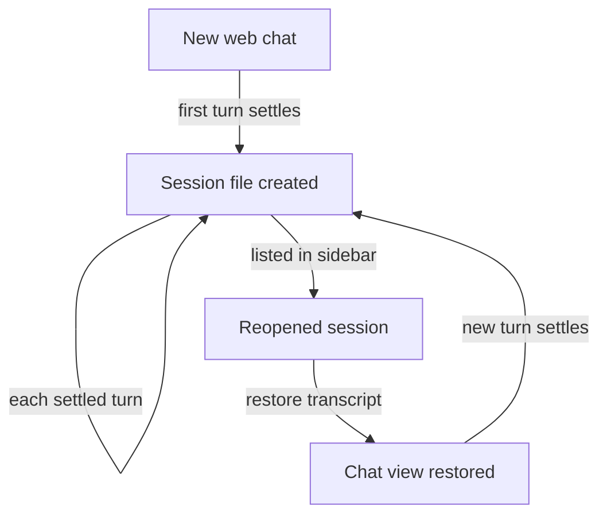
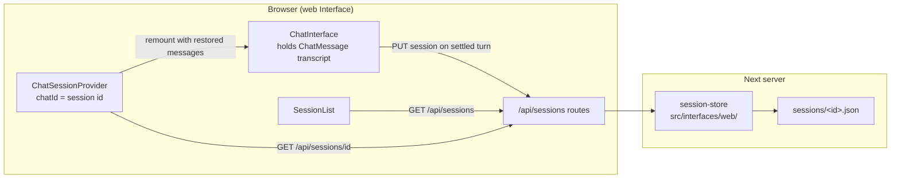

# Session Persistence - Plan

## Goal Capsule

- **Objective:** Filip can close, reopen, and continue past web-chat conversations — a new chat, a page reload, or a server restart no longer loses a conversation.
- **Means:** Session persistence at the web-app layer — one JSON file per session on disk, a session list in the sidebar, and transcript restore into the chat view (KTD1, KTD2).
- **Product authority:** This Product Contract, then `CONCEPTS.md`. Changes to the Core, Discord-side persistence, and session deletion or rename are not active scope.
- **Implementation authority:** Product Contract wins on behavior; Planning Contract KTDs win on mechanism; Implementation Units override neither.
- **Stop conditions:** Stop and ask if meeting a requirement would mean changing the stateless chat request contract (`src/core/chat/contract.ts`) or storing conversation state inside the Core.
- **Execution profile:** Local single-developer change on a Next.js 16 app; no deployment, no migrations, no new external services.
- **Finisher:** `ce-work` (or Filip) implements and verifies in the running app.
- **Open blockers:** None.

---

## Product Contract

*Product Contract preservation: unchanged — ce-plan added implementation sections only.*

### Summary

Web-chat sessions persist to disk as JSON — one file per session under `sessions/` — and past sessions appear in the sidebar, where opening one restores its full transcript and continuing the conversation feeds only the replayable turns back to the unchanged, stateless Core.

### Problem Frame

The Core is deliberately stateless: the caller supplies the whole conversation each request, so the only copy of a web chat lives in the browser's React state.
Starting a new chat remounts the interface and discards it; a reload or server restart loses it entirely.
The Discord Interface never had this problem — the thread itself is the store — but the web Interface has nothing, so every web conversation is ephemeral today.

### Key Decisions

- **Persistence lives at the web-app layer, not the Core.** (session-settled: user-directed — chosen over a Core-level store shared by all interfaces: the Core stays stateless and Discord conversations already persist inside Discord itself.) Governs R1, R7.
- **Sessions reload and continue, not merely archive.** (session-settled: user-directed — chosen over a read-only disk archive: the JSON is load-bearing for resume, not only for outside reading.) Governs R5, R6, R7.
- **The full transcript is stored, not just replayable turns.** (session-settled: user-directed — chosen over storing only `{role, content}` pairs: a reopened session looks the way it did live, while the model still receives only replayable turns.) Governs R3, R6.

### Requirements

**Saving**

- R1. Each web-chat session is stored as one JSON file under a `sessions/` directory at the repo root, which is gitignored like `logs/`.
- R2. A session's file is written or updated after each settled turn; a turn interrupted mid-stream leaves whatever had arrived saved, with its unfinished state recorded.
- R3. A session file holds the full transcript — user and assistant messages, reasoning, tool calls and their outcomes, sources, and timestamps — plus metadata: session id, title, model, and created/updated times.
- R4. A session's title is derived from its first user message, truncated, with a timestamp fallback.

**Listing and reopening**

- R5. Past sessions are listed in the app at the sidebar's existing "Sessions" entry, most recently active first, each showing its title.
- R6. Opening a listed session restores its transcript into the chat view, rendering reasoning, tool calls, and sources as they appeared live.

**Continuing**

- R7. Sending a message in a restored session feeds only the transcript's `{role, content}` turns back to the Core; the stateless request contract is unchanged.
- R8. A continued session keeps its identity — new turns append to the same session file rather than starting a new one.

### Key Flows

- F1. Continue a past conversation
  - **Trigger:** Filip opens a session from the sidebar list.
  - **Steps:** The transcript restores into the chat view; Filip sends a new message; the reply arrives with the earlier turns as context; the same session file updates.
  - **Covered by:** R5, R6, R7, R8
- F2. Lose and recover the live page
  - **Trigger:** A reload, a new chat, or a server restart drops the in-browser conversation.
  - **Steps:** The session file already holds the conversation through its last settled turn; Filip reopens it from the list and continues.
  - **Covered by:** R1, R2, R5, R6

### Acceptance Examples

- AE1.
  - **Covers R1, R5, R6.**
  - **Given** a web chat with several turns, **when** the page reloads, **then** that session appears in the sidebar list and reopening it shows the same transcript, reasoning, tool calls, and sources.
- AE2.
  - **Covers R2.**
  - **Given** a reply streaming when the server restarts, **when** the session is reopened, **then** everything through the interruption is present and the partial reply reads as unfinished.
- AE3.
  - **Covers R7, R8.**
  - **Given** a restored session, **when** Filip sends a follow-up, **then** the reply shows awareness of the earlier turns and the same session file — not a new file — records the exchange.

### Scope Boundaries

- Deleting or renaming sessions from the UI — files can be removed by hand.
- Auto-restoring the in-progress session on reload — reopening via the list covers the recovery.
- A Core-level session store shared with Discord or future interfaces — Discord persists inside Discord itself.
- Searching session contents, exporting, or syncing sessions anywhere off the local disk.

### Outstanding Questions

None — the filename format question is resolved by KTD3 (`sessions/<id>.json`).

### Sources / Research

- `src/components/app-sidebar.tsx` — the "Sessions" entry already exists and currently links to `/`.
- `src/components/chat/types.ts` — `ChatMessage` is the rich client transcript shape R3 persists (reasoning, source, and tool roles included).
- `src/core/chat/contract.ts` — the `{role, content}` replayable shape R7 feeds back; the stream frames in `src/core/chat/stream-frames.ts` carry the richness the transcript captures.
- `src/core/instrumentation/request-log.ts` — the existing precedent for server-side JSON persistence to a gitignored runtime directory (`logs/requests.jsonl`).
- `src/components/chat/chat-session.tsx` — `newChat` remounts `ChatInterface` by key; the same mechanism can remount with restored messages.

---

## Planning Contract

### Key Technical Decisions

- KTD1. **The session store lives in `src/interfaces/web/`, not the Core and not under `src/app/api/`.** (session-settled: user-directed — chosen over colocating the store under `src/app/api/sessions/`: CONCEPTS.md puts a Session in the web Interface, and the module parallels `src/interfaces/discord/`.) Governs R1.
- KTD2. **The browser client owns the transcript and pushes it to a dedicated `/api/sessions` surface; `/api/chat` stays byte-identical.** (session-settled: user-directed — chosen over capturing transcripts inside the chat stream route: that would extend the shared chat request contract the plan forbids changing.) Governs R2, R7, R8.
- KTD3. **The client `ChatMessage[]` shape is the persisted transcript, inside a session envelope.** A session file holds `{id, title, model, createdAt, updatedAt, messages}` where `messages` is the UI transcript verbatim; a turn persisted mid-flight has `status: "streaming"` normalized to an interrupted marker at build time so a reopened partial reply renders as unfinished (R2, AE2). Filename is `sessions/<id>.json`. Governs R2, R3.
- KTD4. **The provider's `chatId` is the session identity, and restore is the existing key-remount with restored messages.** `ChatSessionProvider` already remounts `ChatInterface` on `chatId` change; opening a stored session sets that id and supplies its messages as `initialMessages`, which `ChatInterface` must start honoring (it is accepted but ignored today — wiring it also makes the seeded demo conversation in `chat-data.ts` visible, matching that file's documented intent). Governs R6, R8.
- KTD5. **Every mutating sessions route keeps the JSON content-type gate.** Per `docs/solutions/security-issues/local-api-reachable-from-browser-pages.md`, a route without it can be driven cross-site; `src/proxy.ts` already guards `Host` for all `/api/*`, so only the per-route content-type check is new work.

### High-Level Technical Design

The save path is client-pushed after each turn settles (KTD2); the restore path fetches the stored session into the provider and remounts (KTD4). `/api/chat/stream` and `src/core/` are untouched.

### Assumptions

- Session writes are allowed to fail visibly: the store throws and the PUT route returns an error rather than silently dropping the transcript; the client treats persistence as fire-and-forget and does not block the reply on it, retrying once on the next settle after a failed save.
- The seeded demo conversation (`createInitialMessages`) does not itself create a session file — a session is saved only after a turn was actually sent from that mount.
- Restoring into `initialMessages` reactivates the seeded demo conversation on the first chat; that matches the documented intent in `src/components/chat/chat-session.tsx`.

---

## Implementation Units

### U1. Session model and file store

**Goal:** A typed session envelope plus a filesystem store that writes one JSON file per session under `sessions/`.

**Requirements:** R1, R2, R3, R4 — KTD1, KTD3

**Dependencies:** None

**Files:**
- `src/interfaces/web/session.ts` (new) — session types and pure helpers: `buildSession` (messages + metadata → envelope), `deriveTitle`, `normalizeTranscript` (interrupted marker), `summarize` (session → list item)
- `src/interfaces/web/session-store.ts` (new) — `saveSession`, `readSession`, `listSessions` over `sessions/`; `SPEKTER_SESSIONS_DIR` env override
- `src/interfaces/web/session.test.ts` (new)
- `src/interfaces/web/session-store.test.ts` (new)
- `.gitignore` — add `/sessions/` next to `/logs`

**Approach:**
1. `session.ts` is pure and shared by client and server: the client builds the payload, the server validates it with zod before writing — mirror the zod posture of `src/core/chat/contract.ts`.
2. Title is the first user message's first line, truncated to ~60 chars with an ellipsis; a session with no user message falls back to `Session <YYYY-MM-DD>` (R4).
3. `normalizeTranscript` converts `status: "streaming"` to `status: "error"` with an interrupted marker so a killed turn reads as unfinished on restore (R2, AE2).
4. `session-store.ts` follows `src/core/instrumentation/request-log.ts`: `mkdir -p` on write, missing directory reads as empty, malformed files are skipped in `listSessions`; ids are validated (reject path separators and non-filename-safe values) before joining onto the sessions dir.
5. `listSessions` returns `{id, title, model, createdAt, updatedAt}` sorted by `updatedAt` descending (R5).

**Patterns to follow:** `src/core/instrumentation/request-log.ts` (fs posture, env override, skip-malformed reads), `src/core/chat/contract.ts` (zod schema + `InvalidRequestError`), `src/core/knowledge/markdown-folder.ts` (folder-scan module shape).

**Test scenarios:**
- `buildSession` produces `{id, title, model, createdAt, updatedAt, messages}` and `readSession` returns the identical object after `saveSession` (round-trip).
- `deriveTitle` returns the truncated first line of the first user message; a multi-line first message uses only its first line; a transcript with no user message falls back to the timestamp label.
- `normalizeTranscript` turns a `status: "streaming"` assistant reply into an interrupted error state and a streaming reasoning message likewise; settled messages pass through unchanged (covers AE2's stored shape).
- `summarize` returns id/title/updatedAt without the messages array.
- `listSessions` on an empty or missing `sessions/` dir returns `[]`; on a dir containing one valid session plus one malformed JSON file returns only the valid summary.
- `listSessions` orders two sessions by `updatedAt` descending.
- `readSession` returns `null` for an unknown id.
- `saveSession`/`readSession` reject or refuse an id containing `../` or a path separator.
- Storage honors `SPEKTER_SESSIONS_DIR` pointing at a `mkdtemp` dir (mirror `withTempRequestLog` in `src/core/testing/request-log.ts`).

**Verification:** `vitest run` covers the two new test files; `.gitignore` contains `/sessions/`.

### U2. Sessions API routes and client

**Goal:** `GET /api/sessions`, `GET /api/sessions/[id]`, and `PUT /api/sessions/[id]` over the U1 store, plus a typed client the browser uses.

**Requirements:** R1, R5, R6 — KTD2, KTD5

**Dependencies:** U1

**Files:**
- `src/app/api/sessions/route.ts` (new) — `GET` returns the summary list
- `src/app/api/sessions/[id]/route.ts` (new) — `GET` returns one session, `PUT` upserts it
- `src/app/api/sessions/route.test.ts` (new) — route tests against a temp sessions dir
- `src/interfaces/web/session-client.ts` (new) — `listSessions()`, `getSession(id)`, `putSession(session)` fetch wrappers
- `src/interfaces/web/session-client.test.ts` (new)

**Approach:**
1. `PUT` requires `Content-Type: application/json` and rejects otherwise with `InvalidRequestError`, per KTD5; the body must zod-validate as a session and its `id` must equal the route `id` (mismatch → 400).
2. Dynamic `params` is a promise in this Next version: `{ params }: { params: Promise<{ id: string }> }`, `await params` — see `node_modules/next/dist/docs/01-app/03-api-reference/03-file-conventions/route.md`.
3. `GET [id]` returns 404 for unknown or invalid ids via `readSession`'s `null`; errors reuse `errorResponse` from `src/app/api/chat/http.ts`.
4. `session-client.ts` mirrors `src/interfaces/discord/spekter-api.ts`: thin typed fetch wrappers; `getSession` maps 404 to `null`.

**Patterns to follow:** `src/app/api/workspace/tree/route.ts` (GET handler shape), `src/app/api/chat/route.ts` (content-type gate), `src/app/api/chat/http.ts` (`errorResponse`, `InvalidRequestError`), `src/app/api/chat/stream/route.test.ts` (route test style), `src/core/testing/request-log.ts` (temp-dir test helper pattern).

**Test scenarios:**
- `GET /api/sessions` returns `[]` with no sessions dir, then the summaries after two `PUT`s.
- `PUT` with `Content-Type: text/plain` returns 400 (the security gate from the cited solutions doc).
- `PUT` with a body that fails the session schema returns 400; `PUT` whose URL id differs from `body.id` returns 400.
- `GET /api/sessions/[id]` returns the stored session; an unknown id returns 404.
- A non-local `Host` rejection stays covered by `src/proxy.ts`'s existing `/api/:path*` matcher — confirm `src/proxy.test.ts` still passes.
- `session-client`: `listSessions` parses the response; `getSession` returns `null` on a 404 and throws on other non-2xx; `putSession` sends `PUT` with the JSON body.

**Verification:** `vitest run` covers the new route and client tests; `curl -X PUT -H 'content-type: text/plain'` against the running dev server returns 400.

### U3. Persist turns from the chat view

**Goal:** Every settled turn upserts the session file, and `ChatInterface` honors `initialMessages` so a transcript can be restored.

**Requirements:** R2, R3, R7, R8 — KTD2, KTD3, KTD4

**Dependencies:** U2

**Files:**
- `src/components/chat/ChatInterface.tsx` — session id prop, save-on-settle effect, `useState(initialMessages)`
- `src/components/chat/chat-session.tsx` — pass session identity through to `ChatInterface`
- `src/app/page.tsx` — thread the session id prop

**Approach:**
1. `ChatInterface` takes a `sessionId` prop used as the file id on save; `ActiveChat` passes the provider `chatId`, substituting a freshly minted uuid when `chatId` is the `"initial"` sentinel so the first real chat still gets a real file id.
2. Initialize state with `useState(initialMessages)` — the prop is currently accepted and ignored; this both restores sessions and shows the seeded demo conversation on first load (documented intent).
3. Save on settle, not per frame: an effect fires when a turn has been sent from this mount, `isThinking` is false, and the transcript holds a user message; it builds the session via `buildSession`/`normalizeTranscript` and calls `putSession` fire-and-forget (failures log, never block the composer). A mount carrying restored or seeded messages does not save until a turn is sent from it — gate the effect on a dirty flag set inside `sendMessage`.
4. Continuing needs no new code path: `sendMessage` already calls `toConversation`, which extracts exactly the replayable turns R7 requires.
5. A session id maps to exactly one conversation. The in-component "New session" button currently resets messages while keeping the same `sessionId`, which would let a new conversation overwrite the previous session's file — route its reset through the provider's `newChat()` so both reset paths mint a fresh id, and remove the duplicated reset.
6. A failed save retries once on the next settle; a save that keeps failing while the server is down leaves the in-flight turn unsaved until a later turn succeeds — accepted residual gap for AE2's edge.

**Patterns to follow:** `src/components/chat/stream-client.ts` (`toConversation` reuse), the effect/flag style already in `ChatInterface` (`followBottomRef`).

**Test scenarios:**
- The save-eligibility predicate (extracted as a pure helper, e.g. `shouldPersist`) is false on a mount with restored/seeded messages and no sent turn, false while `isThinking`, and true after a sent turn settles.
- A saved payload's `messages` include reasoning, source, and tool roles verbatim, and `toConversation` over the same transcript yields only `{role, content}` turns (covers the R3/R7 split).
- A session continued after restore keeps the same `sessionId` on the next `putSession` call (covers R8's identity, assertable on the client layer).
- Starting a new chat after a saved session rotates the session id: the next save writes a different file and the previous session's file is untouched.

**Verification:** Manual — chat a few turns, confirm `sessions/<id>.json` appears and grows per turn; reload and reopen the session. `npm run lint` clean.

### U4. Session list and restore in the sidebar

**Goal:** Past sessions are listed under the sidebar's "Sessions" entry, and clicking one restores its transcript into the chat.

**Requirements:** R5, R6 — KTD4

**Dependencies:** U3

**Files:**
- `src/components/session-list.tsx` (new) — client component rendering the summary list
- `src/components/app-sidebar.tsx` — mount `SessionList` beneath the "Sessions" entry
- `src/components/chat/chat-session.tsx` — `openSession(id)` on the provider; `ActiveChat` passes restored messages
- `src/interfaces/web/session.ts` — `restoreMessages` mapping (session → `initialMessages`)
- `src/interfaces/web/session.test.ts` — `restoreMessages` cases

**Approach:**
1. `ChatSessionProvider` gains `openSession(id)`: it calls `getSession(id)`, stores the restored `initialMessages`, and sets `chatId` to the session id; the key-remount then rebuilds `ChatInterface` with the transcript (KTD4). A 404 leaves the current chat untouched.
2. `restoreMessages` maps the stored transcript back to `ChatMessage[]` for `initialMessages` — verbatim, since normalization already ran at save time (KTD3).
3. `SessionList` fetches `listSessions()` on mount, whenever `chatId` changes, and whenever the provider's sessions version bumps — the provider increments it after each successful `putSession`, so a session appears in the list as soon as its first save lands. It renders title and relative time per item, highlights the active `chatId`, and calls `openSession` on click. An empty list renders a quiet "No sessions yet" label.
4. The existing "Sessions" `SidebarMenuButton` stays; `SessionList` renders directly under it.

**Patterns to follow:** `src/components/workspace-tree.tsx` (client component fetching a `/api` route for the sidebar), `src/components/chat/chat-session.tsx` (context shape), `src/components/app-sidebar.tsx` (sidebar item styling).

**Test scenarios:**
- `restoreMessages` returns the stored transcript in order with roles, sources, and tool states intact, suitable to pass as `initialMessages` (covers AE1's restore shape).
- `restoreMessages` surfaces an interrupted assistant reply as an error-state message, so the partial reads as unfinished (covers AE2's display).
- `openSession` on a 404 leaves `chatId` and messages unchanged (assertable on the provider logic via mocked `getSession`, or verified manually if the provider stays too thin to isolate).

**Verification:** Manual — a saved session appears in the sidebar, clicking restores the full transcript including reasoning and tool rows, and continuing writes to the same file. `npm run lint` clean.

---

## Verification Contract

| Gate | Command | Proves |
|---|---|---|
| Unit tests | `npm run test` | U1–U4 scenarios pass (store round-trip, title/interruption normalization, route gates, client error mapping, restore mapping) |
| Lint | `npm run lint` | New modules and touched components match repo style |
| Build/typecheck | `npm run build` | No type or build regressions, including the async `params` signature |
| Security convention | Route tests in U2 + `src/proxy.test.ts` | PUT without JSON content-type → 400; non-local `Host` → 403 |
| Manual smoke | `npm run dev` | AE1–AE3 walk through in the browser: save → reload → reopen → continue → interrupted turn reads as unfinished |

## Definition of Done

- R1–R8 hold in the running app: sessions persist under gitignored `sessions/`, list in the sidebar, restore the full transcript, and continue on the same file through the unchanged chat contract.
- `npm run test`, `npm run lint`, and `npm run build` are green.
- The AE1–AE3 flows are verified manually once against `npm run dev`.
- `src/core/` and the Discord interface are untouched by the diff.
- Any abandoned-attempt code (alternate save triggers, unused restore helpers) is removed before declaring done.
